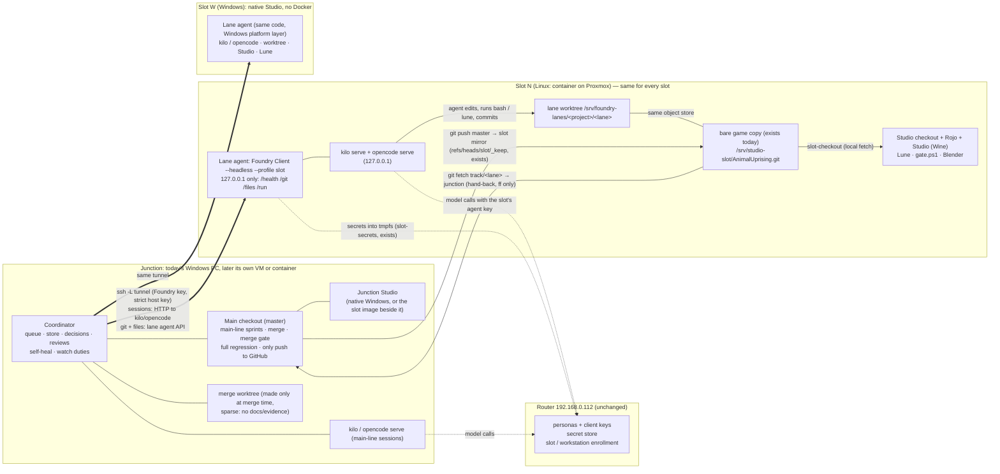

# Distributed Foundry: coding on the slots, the workstation as the junction

Status: **approved 2026-11-27 (D1-D7 as recommended). Phase a (the platform layer, both clients in
the slot image) is built in v0.181.263; phases b-f are not started.**
The phased plan is `docs/plans/DISTRIBUTED_FOUNDRY_PLAN.md`.

Every `file:line` below was read on `origin/main` at `1acbade` (v0.181.262). The OneDrive dev
checkout is older (v0.181.253), so some line numbers differ there. Counts ("160 calls") come from
`grep` over `foundry_coordinator/`.

## 0. In short

- **The coordinator does not move.** It keeps the queue, the store, the decisions, the reviews, the
  merges and every watch duty. What moves is where a lane's **files, coding sessions, Lune runs
  and Studio gate** run: on the slot the lane is bound to.
- **The slot gets a small "lane agent"**: the Foundry Client in headless mode with a slot profile.
  It runs `kilo serve` and `opencode serve` on `127.0.0.1` inside the slot, plus a small HTTP API
  for git and file reads. The coordinator reaches it through **one ssh tunnel per slot**, with the
  ssh key and strict host-key check it already uses. Nothing new listens on the LAN.
- **Two seams already exist**, and most of the work goes through them:
  - every git call the coordinator makes on a workspace goes through one function,
    `Workspace.run` (`foundry_coordinator/adapters/git.py:39-54`), used 160 times;
  - every session call already names its folder (`directory=`), 101 times. The Kilo and OpenCode
    clients are HTTP clients with a URL (`foundry_coordinator/adapters/__init__.py:40-55`).

  A remote lane gets a `RemoteWorkspace` (git through the agent) and a client whose URL is the
  tunnel. The 79 places that open worktree files directly move to a small read API, one module at
  a time.
- **The junction (today's PC) stays the only publisher.** It fetches each lane branch from the
  slot's bare copy. A slot never gets GitHub credentials and never pushes to the shared remote.
  The merge, the merge gate, the main-line sprints and the full regression stay on the junction.
- **Everything is behind switches** (`[slots.slot-N] lanes = true`, `[automation]
  remote_lanes`), off by default. The local mode keeps working unchanged. Each phase ships and
  rolls back on its own.
- **Two corrections to the brief:**
  - EditableImage is **not** a slot limit any more. It was a place setting ("Allow Mesh / Image
    APIs"), now on in all three slot places. slot-1 proved it with S46 23/23, including c6.
  - The AlwaysOnTop billboards are left out by **CaptureService itself**, not by Wine (details in
    §7).

## 1. How it works today (verified)

### 1.1 Lanes, tracks and slots

| Claim | Where |
|---|---|
| A track is a git worktree at `<workspace>/.tracks/<name>` on branch `track/<name>`, cut from master | `foundry_coordinator/tracks/manager.py:1-12`, `:44`, `:479-497` |
| `max_agents` caps the sprints running at once; slot 0 is the main checkout's | `tracks/manager.py:13-18`, `:154-157` |
| A track's slot is stored in the track row (`data.slot`) and read back by `slot_id_of` | `tracks/manager.py:499-500`; `foundry_coordinator/slots.py:104-114` |
| `[slots.slot-N]` settings, their defaults, and the remote form (`host`, `au_push_url`, `foundry_push_url`, `foundry_host_dir`) | `slots.py:15-38`, `:68-73`, `:85-101` |
| Slot settings can also arrive in a router revision; a `slots.` change waits for a safe point | `foundry_coordinator/config_pull.py:57` |
| The live AU `project.toml` defines `slot-1` (container `studio-slot-poc`, no `host`) and `slot-3` (`studio@192.168.0.117`); the other slot settings come from the router revision | `foundry-deploy/.../animaluprising/project.toml` (git-ignored, read 2026-11-27) |
| A remote slot is driven over ssh: every command is `ssh <host> docker exec ...` | `slots.py:171-183` |
| The ssh key is Foundry's own, registered with the router; slot host keys are checked strictly | `foundry_coordinator/slot_ssh.py:1-21`; `slots.py:151-160` |
| Sprints that measure frame time or performance never go on a slot track | `tracks/manager.py:654-667`; `[automation] workstation_only_sprints` (`foundry_automation/schema.py:386`) |

### 1.2 The Studio gate on a slot

| Claim | Where |
|---|---|
| A slot-bound track's gate is wrapped to run inside the slot | `foundry_coordinator/studio_calls.py:833-841` → `slots.wrap_pipeline` (`slots.py:195-211`) |
| The wrapper pushes the track's commit to the host's bare mirror as `slot/<task>`, and the running Foundry to the host's Foundry mirror | `slots.run` (`slots.py:545-586`), `push_sources` (`:257-314`) |
| Those pushes use `--force`, but only to the slot's private mirror refs (`slot/<task>`, `deploy`), never the shared remote | `slots.py:273`, `:290` |
| The slot's checkout is moved with `slot-checkout`, the pipeline runs, and outputs matching `docs/progress/<ID>_*`, `docs/evidence/<ID>`, `.plan/tmp/gate/<ID>` are tarred back into the workstation worktree | `slots.py:59`, `:561-586`, `copy_back` `:384-400` |
| A lane's first push used to take over 30 min at ~50 KB/s; `slot-keep` now pushes master to idle slots every 4 h | `slots.py:269-274`; `foundry_coordinator/slotkeep.py:5-10`, `:127-148`, `:215-219` |
| Slot upkeep (disk %, Foundry version, keep-fresh) runs on worker threads, never on the tick thread | `slotkeep.py:18-20`, `:189-231`, `:234-269` |
| Track sessions reach the slot's Studio: their kilo.jsonc Studio MCP servers become `ssh host docker exec -i ...` | `slots.py:618-644`; `tracks/manager.py:504-513`, `:688-740` |
| Main sprints can already put their Studio on a slot (`[studio] main_slot`, built in W2, off) | `slots.py:117-142`, `:647-684` |
| One Lune spec-cache folder per lane on the slot | `slots.py:74-78`, `:186-192`, `:214-225` |
| Lune PASS results are reused by a content key (git object ids + Packages hashed from disk). The store is in the coordinator's state dir | `foundry_coordinator/projects/animaluprising/lune_cache.py:1-18`, `:122`, `:203-204` |
| Blender already runs on slots through `foundry-blender`: one `docker exec` holds a `flock`, sends the uncommitted files in, and takes the outputs back | `foundry_coordinator/slot_blender.py:1-21`, `:39-46`, `:737` |

### 1.3 Coding sessions

| Claim | Where |
|---|---|
| The Foundry Client starts `kilo serve` and `opencode serve` bound to `127.0.0.1` | `foundry_client/components.py:207-215`, `:219-232` |
| The project's client comes from `[client]`; with `[clients.<name>]` and `[client_roles]` it becomes a `ClientSet`, one server per role | `adapters/__init__.py:40-77`; `adapters/clientset.py:1-22` |
| The live AU client is Kilo at `http://127.0.0.1:4096` | live `project.toml` `[client]` |
| The Kilo / OpenCode 1.x API is HTTP with `?directory=<folder>` on every call | `adapters/oc1.py:10-22`, `:108-112` |
| The engine starts a session in `P.profile.workspace`, with the role's permission rules | `foundry_coordinator/engine.py:1145-1155`, `:1227` |
| The model key is only ever an `{env:...}` reference in the agent config | `foundry_coordinator/agent_config.py:53-67` |
| Every git call on a workspace goes through `Workspace.run`. 160 `.ws.` calls, 101 `directory=` session calls, and about 79 direct `os.path.join(<workspace>, ...)` reads in 15 files | `adapters/git.py:35-54`; grep counts |
| A merge rebases in the track worktree, fast-forwards master in the main checkout, then gates there | `tracks/merge.py:382-400`, `:649-660`, `:717`; stages `:1-37` |
| Only the main checkout pushes to the remote | `engine.py:4025-4035` (`P.ws.push`) |

### 1.4 Machines and installers

| Claim | Where |
|---|---|
| The slot image: Debian 13, Vinegar 1.9.4 + Wine, Rojo 7.7.1, Node 22.21, robloxstudio-mcp 3.4.2, PowerShell 7.6.9, rokit, Blender 4.5.12, Python 3. **No Kilo, no OpenCode** | `contrib/studio-slot/Dockerfile:7-127`; `README.md:58-71` |
| The slot installer targets a Proxmox **LXC** (`create-slot-lxc.sh` runs `setup-host.sh` inside it) and works on any Debian 13 machine. The brief calls the slots VMs; the design works for either | `contrib/studio-slot/proxmox/setup-host.sh:1-24` |
| The slot's own key has the `secrets` scope only (no inference) | `foundry_router/ui/setup_routes.py:51`; `contrib/studio-slot/slot-secrets.py:13`, `:24` |
| A Linux workstation installer exists (`install/workstation.sh`, `create-workstation-lxc.sh`), with headless client, systemd unit and enrollment | `install/workstation.sh:1-42`; `foundry_client/__main__.py:3-8`; `foundry_client/autostart.py:103-128` |
| On Windows the client autostarts through `schtasks` | `foundry_client/autostart.py:8-11` |
| One active workstation per project, the others on standby | `foundry_router/machines.py:282-284`, `:1064` |
| Platform code is spread out: about 20 coordinator files branch on `os.name` / `sys.platform`; the `CREATE_NO_WINDOW` constant is copied in 8 files; the client's Studio watchdog handles Windows windows only | grep; `foundry_client/studio.py:1-12` |
| The client stops any pytest job past 60 min / 4 GB | `foundry_client/resources.py:46` |

### 1.5 What the slots cannot do today (and what they can)

| Limit | Status | Source |
|---|---|---|
| Frame timing and performance | **Real.** Software rendering at ~36 fps; never judged on a slot | memory note *slots-no-timing-work*; `tracks/manager.py:654-667` |
| EditableImage (minimap) | **Fixed, not an OS limit.** It was the place setting "Allow Mesh / Image APIs". It is on in all three slot places (2026-11-14); slot-1 proved it with S46 23/23 including c6. The old text in `KNOWN_ISSUES.md:1813-1815` is stale | AU `docs/evidence/POL-7/prework/OUT_OF_DATE.md:52-56` |
| AlwaysOnTop billboards in frames | **A CaptureService behaviour**, not marked slot-only. The Studio viewport and `tools/capture-window.ps1` (a Windows window grab) draw them. Stagers depth-test them for the frame | AU `docs/memory/KNOWN_ISSUES.md:2637`, `:2136` |
| Dressed boss and mini-boss models | **Real on slots:** they did not draw | AU `docs/evidence/POL-7/prework/OUT_OF_DATE.md:50` |
| `ContentProvider:PreloadAsync` | Failed for every id on slot-2 | AU `docs/memory/KNOWN_ISSUES.md:1465` |
| 2-player playtests | Need ~14 GB; off where memory is short | `contrib/studio-slot/docker-compose.yml:23-27`; `README.md:177-178` |

## 2. Target architecture



### 2.1 What runs where

| Piece | Junction | Slot (lane host) |
|---|---|---|
| Coordinator, store, queue, decisions, Lead, reviews, self-heal, control center | **yes, only here** | no |
| Main checkout, main-line sprints, their sessions | yes | no |
| Lane worktree, its coding sessions (Kilo or OpenCode) | no (unless the lane is local) | **yes** |
| Agent bash, `lune`, `selene`, `stylua`, `wally` during a session | main line only | **yes, for its lane** |
| Studio gate (host half + scripted Studio + `-Finish`) for a lane | no | **yes** (as today) |
| Studio MCP for a lane's sessions | no | **yes, local stdio** (no ssh hop any more) |
| Blender for a lane | via the Blender pool (as today) | **yes, local** when the lane is on a Blender slot |
| Merge (rebase / ff), merge gate, `studio_batch`, full regression | **yes, only here** | no |
| Push to GitHub / `origin` | **yes, only here** | **never** (no credentials) |
| Reviews (reviewer sessions) | yes: they read the lane's diff through the fetched branch | no |
| Lune PASS cache (content-keyed) | **yes:** one store, filled by every lane | keys are computed where the files are |

A lane can still be local (today's behaviour). A slot can serve one lane at a time; a slot with
more cores could serve two later (`lanes_max`, default 1), but this design does not need that.

## 3. The lane agent

> **As built (v0.181.265, phase b-1):** the "slot profile" is the client's `[lane]` table
> (`enabled`, `root`, `secrets_file`, `listen`) in `foundry_client/config.py`; the routes are
> in `foundry_client/lane.py` + `api.py` and take a separate lane token (header
> `X-Lane-Token`), which opens only `/api/lane/*`. Inside a container the servers listen on
> all addresses and compose publishes them on the slot host's 127.0.0.1 only (a container's
> own loopback cannot be forwarded). Details and the other findings:
> `docs/plans/DISTRIBUTED_FOUNDRY_PHASE_B.md`.

The lane agent is the **Foundry Client in headless mode with a `slot` profile**
(`foundry-client run --headless --profile slot`). It is not a new program:

- it already supervises `kilo serve` and `opencode serve` with health checks and restart
  (`foundry_client/components.py:207-232`);
- it already runs headless and installs a systemd unit (`foundry_client/autostart.py:103-128`)
  or a scheduled task on Windows (`:8-11`);
- its local API already exists (`foundry_client/api.py`); the slot profile adds four routes.

**New routes (127.0.0.1 only, one bearer token per slot, kept in tmpfs):**

| Route | What it does | Guard |
|---|---|---|
| `GET /lane/health` | kilo/opencode health, Studio up, Rojo up, disk %, load average, free memory, Foundry version, the lanes it holds and their HEADs | read-only |
| `POST /lane/git` | runs `git -C <lane worktree> <argv>`, returns rc/stdout/stderr | argv as a list, never a shell; allow-listed subcommands (the ones `Workspace` uses); the worktree must be one the agent holds |
| `GET /lane/file`, `POST /lane/stat` | read one file (capped) or stat a list of paths inside a lane worktree | realpath must stay inside the worktree; no `.git` |
| `POST /lane/run` | runs a named job (`gate`, `lune`, `worktree-add`, `worktree-remove`, `fetch-base`, `copy-outputs`) with a run id; output streams back; `GET /lane/run/<id>` re-attaches after a network blip | named jobs only, no free commands |

**The tunnel.** For each slot with lanes on, the coordinator keeps one `ssh -N -L
<local port>:127.0.0.1:<agent port> -L <p2>:127.0.0.1:4096 -L <p3>:127.0.0.1:4097 <host>`
process alive. It uses the same key and known_hosts as every other slot command
(`slot_ssh.ssh_options`). One long-lived tunnel, not one ssh per call: Windows OpenSSH has no
`ControlMaster`, and today's per-command ssh costs 0.2-1 s each, which 160 git call sites cannot
afford.

## 4. A remote session: start, watch, recover, stop

### 4.1 Start

1. **Bind.** `tracks start <project> <lane> <sprints> --slot slot-2` with `[slots.slot-2] lanes =
   true` makes a **remote lane**. With `lanes = false` (the default) it is today's track: the
   worktree on the junction, Studio on the slot.
2. **Base.** The junction pushes the base commit to the slot's bare copy, the same push
   `slot-keep` makes (`slotkeep.py:127-148`), to `refs/heads/slot/_base/<lane>`.
3. **Worktree.** The agent runs `worktree-add`: `git -C <bare> worktree add -b track/<lane>
   /srv/foundry-lanes/<project>/<lane> <base>`, then `wally install` (as `slot-checkout` does
   today). The store's track row records `host = slot-2` and the slot-side path.
4. **Agent config.** The coordinator writes the lane's `kilo.jsonc` / `opencode.jsonc` through
   `/lane/run worktree-config` (today `services.track_kilo_config`,
   `foundry_coordinator/services.py:353`). The Studio MCP servers are now plain local commands in
   the slot (`/usr/local/bin/studio-mcp-official`, `robloxstudio-mcp`), not `ssh ... docker exec`.
5. **Session.** The engine's `start_session(directory=<slot path>, ...)`
   (`engine.py:1145-1155`) goes to a `KiloClient` / `OpenCodeClient` whose URL is the tunnel's
   local port. The project gets one `ClientSet` member per slot server
   (`adapters/clientset.py`), picked by the lane's host instead of only by role.
6. **Model calls** go from the slot's kilo/opencode to the router with the **slot's agent key**
   (new, inference scope, client name `<slot>-kilo` / `<slot>-opencode`, same persona allow-list
   as `kilo` / `opencode`). The key arrives through `slot-secrets` into `/run/secrets` and reaches
   the server as an environment variable; the config holds only `{env:...}`
   (`agent_config.py:53-67`).

### 4.2 Watch

- **Sessions:** unchanged. The engine polls `P.client.state(...)`, transcripts, questions and
  permissions (`engine.py:4158`, `:4496`, `:2041`, `:2071`) over HTTP; the tunnel makes them
  local calls. Self-heal (`foundry_coordinator/selfheal.py:196`, `:346`, `:380`) works on the
  store and the client, so it needs no change.
- **The slot:** a worker thread per slot (the `slotkeep` pattern, never the tick thread) reads
  `/lane/health` every 60 s. The board and the control center get a host column: `local`,
  `slot-2`, ...; remote sessions show the same pill, heartbeat and transcript as local ones.
- **Heartbeat cover:** a gate or Lune run on a slot is a `/lane/run` job. The coordinator waits on
  it inside `keepalive.busy(...)` (`foundry_coordinator/keepalive.py:1-15`), as it does for local
  verifies.

### 4.3 Recover

Self-heal stays in the coordinator; the agent only reports and runs jobs.

- **Tunnel down:** the coordinator restarts the tunnel (backoff 5 s → 2 min). Sessions keep running
  on the slot meanwhile: Kilo and OpenCode do not need the coordinator to keep working.
- **kilo/opencode down on the slot:** the agent restarts it (client component rule). Lost sessions
  are found again by `ClientSet`'s "ask each server" lookup (`clientset.py:16-20`), else the
  existing dead-session rule reruns the step.
- **Agent down or slot gone:** see §8.

### 4.4 Stop

- **Session abort:** `P.client.abort(...)` as today.
- **Lane stop:** `tracks stop` aborts the sessions. It asks the agent to stop the lane's jobs, then
  **fetches the branch to the junction before anything else**, so stopping never strands commits
  (memory note *stranded-track-work*). The slot worktree is removed only after the junction
  holds the branch tip (`git rev-parse` checked on both sides).

## 5. How code, caches and evidence move

| What | Direction | How | Notes |
|---|---|---|---|
| Base commit (master) | junction → slot | `git push` to `refs/heads/slot/_base/<lane>` on the bare copy | Small: `slot/_keep` keeps the copy within 4 h of master (`slotkeep.py:5-10`) |
| Lane commits | slot → junction | **junction pulls**: `git fetch ssh://<host>/srv/studio-slot/AnimalUprising.git track/<lane>:refs/lanes/<slot>/<lane>`, then `update-ref refs/heads/track/<lane>` **fast-forward only** | Pull, so a slot needs no key to the junction. A non-ff tip stops the lane with a decision; nothing is overwritten |
| When the junction fetches | — | after every commit the coordinator records (it sees the HEAD move in `/lane/health`), before a review, before a merge, before a stop | The junction always holds the newest committed work |
| Uncommitted work | stays on the slot | `slot-keep save-dirty` already copies a checkout's dirty files to the junction (`slotkeep.py:333-354`); a lane stop runs it for the lane worktree | Nothing is discarded |
| Gate outputs (`docs/progress/<ID>_*`, `docs/evidence/<ID>`, `.plan/tmp/gate/<ID>`) | Studio checkout → lane worktree, **both on the slot** | the same `OUTPUT_GLOBS` filter (`slots.py:59`), copied locally instead of tarred over ssh | The coordinator commits them through `/lane/git`, as it commits them locally today |
| Revision-bound evidence | travels with git | it is bound to a commit SHA; the same objects exist on both sides | No change to the rules |
| Lune spec cache | stays on the slot | the per-lane folder already exists (`slots.py:74-78`) | A new lane on a slot starts warm from the Studio checkout's cache (`slots.py:214-225`) |
| Lune PASS results | slot computes the key, junction stores it | `lune_cache.input_key` runs through `/lane/git` and `/lane/stat`; `get`/`put` stay in the junction's state dir (`lune_cache.py:203-204`) | A PASS on a slot carries to the merge gate when the inputs match: never rerun passed work |
| Blender outputs | stay on the slot | the lane's own Blender runs in the lane worktree; no tar round-trip | `foundry-blender` on a junction lane is unchanged |
| Project memory (`docs/memory/**`) | with the branch | merge already resolves memory conflicts by union (`tracks/merge.py:168`) | — |
| Foundry release on the slot | junction → slot | the Foundry mirror push that exists (`slots.py:285-313`) also feeds the agent's checkout; the agent refuses lanes when its version differs from the coordinator's (`slotkeep.view` already reads it, `slotkeep.py:272-295`) | — |

**Merging a remote lane.** Recommended first version (D4): merge on the **junction** in a
**merge worktree** made only at merge time from the fetched branch, as a sparse checkout without
`docs/evidence/` (the blobs are in the object store; only the checkout is skipped).
`tracks/merge.py` then runs as it does today with `wt` = that worktree: rebase or merge
(`:382-400`), Lead repair on a conflict (`:504-548`, the repair session runs on the junction),
ff (`:649-660`), gate and `studio_batch` in the main checkout (`:717`, `:884-942`). The slot
worktree is removed after `track_merged`. Later option: rebase on the slot to skip the junction
checkout, once phase (d) has run a few weeks.

## 6. Choosing Kilo or OpenCode

Both are installed in every container image (slot, junction) and on Windows slots, pinned like
everything else. Today's Kilo is 7.8.x from npm; OpenCode is 2.3.2 (`@opencode/cli`).

**Config** (the existing tables, `adapters/clientset.py:1-22`, plus two optional overrides):

```toml
[client]                 # the project default: AU stays on Kilo
kind = "kilo"
[clients.opencode]       # declared once; on a slot the URL is rewritten to the slot's tunnel
kind = "opencode"
[client_roles]           # existing per-role override
# helper = "opencode"
[automation]
lane_client = {}         # NEW, optional: {"<lane>" = "opencode"} per lane
# per sprint: a plan header line `Client: opencode` (NEW, optional), checked at session start
```

- **Which wins:** sprint → lane → role → project default.
- **Switching back:** one line (`kind = "kilo"`), then the existing **Reload** at a safe point
  (`config_pull.py:57`). No rebuild, because both binaries are always present.
- **The next project** sets `[client] kind = "opencode"`. Its personas still come from the router:
  the `opencode` client key reuses the `Foundry-Kilo-*` personas (memory note
  *opencode-backend-plan*).
- **Both clients run on the slot** (`kilo serve` on 4096, `opencode serve` on 4097, both on
  127.0.0.1). The agent starts only the ones some lane or role names, so an unused one costs no
  memory.

## 7. Linux and Windows

### 7.1 One platform layer

A new module `foundry_platform/` (stdlib only). Every OS branch in the coordinator, the client and
the agent moves into it:

| Area | Linux | Windows |
|---|---|---|
| Paths | `/srv/foundry`, `/srv/foundry-lanes` | `C:\Foundry`, `C:\Foundry\lanes` (short: Windows path limits; memory note *parallel-pytest-basetemp*) |
| Shell for jobs | `bash -lc` | `pwsh -NoProfile -Command` |
| Process start / kill tree / no console window | `start_new_session`, `killpg` | `CREATE_NO_WINDOW` (now copied in 8 files), Job Objects / `taskkill /T` |
| File locks | `fcntl.flock` (slot Blender uses `flock` today, `slot_blender.py:1-21`) | `msvcrt.locking` / `LockFileEx` |
| Services | systemd `--user` (`autostart.py:103-128`) | scheduled task (`autostart.py:8-11`) |
| Studio driver | `container`: `docker exec` (today) | `native`: the client's `studio.py` reopen and the Studio MCP over npx (today's workstation) |
| Text encoding | UTF-8 | always pass `encoding="utf-8"` (memory note *workstation-cp1252-default*: cp1252 broke 84 AU files) |

The slot's OS is a field: `[slots.slot-4] os = "windows"`, `studio = "native"`. Nothing else in
the logic asks which OS a slot runs.

**Tests on both:** a GitHub Actions matrix (`ubuntu-latest`, `windows-latest`) runs the unit tests
of `foundry_platform`, the agent routes and `RemoteWorkspace` against a scripted git repo. A
scripted smoke run (§9, `foundry-client doctor --lane`) runs on a real spare Linux slot and a real
spare Windows slot before each release that touches this code.

### 7.2 Mixed fleets

- **Windows junction (today's PC) managing Linux slots:** the default path. ssh from Windows
  OpenSSH (as today), the tunnel per slot.
- **Linux junction managing Windows and Linux slots:** the junction container has OpenSSH. A
  Windows slot runs the Windows OpenSSH server, and git over ssh uses
  `git-upload-pack` from Git for Windows.
- **The junction's own Studio:** native Studio on a Windows junction (today), or the slot image as
  `studio-main` next to a Linux junction (`[studio] main_slot`, built in W2, `slots.py:117-142`).

### 7.3 What differs by OS

| Topic | Linux slot (container) | Windows slot (native) |
|---|---|---|
| Studio | Vinegar 1.9.4 + Wine 10, `D3D11` renderer, software or iGPU DXVK (`README.md:58-71`, `:177-179`) | Roblox's own installer; Studio updates itself (cannot be pinned) |
| Speed and frame timing | ~36 fps in software; never judged here | Real GPU: **frame timing could be judged on a Windows slot with a GPU**; the `workstation_only_sprints` rule then reads "needs a real renderer" instead of "needs the workstation" |
| EditableImage (minimap) | works since the place setting was turned on (§1.5) | works (the same place setting) |
| AlwaysOnTop billboards | CaptureService leaves them out; depth-test staging works | CaptureService leaves them out too as far as we know (KNOWN_ISSUES does not say slot-only); `tools/capture-window.ps1` grabs the real window, which draws them. **To confirm in phase (b) with one UX-1 probe** |
| Dressed boss models, `PreloadAsync` | did not draw / failed (§1.5) | expected to work (same as the workstation); **to confirm in phase (b)** |
| Multiple Studios per machine | one per container; each slot needs its own place | one signed-in Studio per Windows user session; **one slot per Windows machine or VM** |
| Blender | 4.5.12 Linux tarball, `blender -b` (`Dockerfile:42-51`) | 4.5.12 Windows build (the workstation's `slot_blender.LOCAL_EXE`, `slot_blender.py:410`) |
| Kilo / OpenCode | npm `-g` on Node 22 (in the image) | npm `-g` (`kilo.cmd`, `opencode.cmd`; the client already looks for both, `components.py:207-208`) |
| Desktop for sign-in | noVNC on the slot | RDP, or the console |
| Service | systemd | scheduled task, run whether the user is signed in or not; Studio needs a signed-in desktop session (auto-logon on a dedicated VM) |
| Licence | none | a Windows licence per slot |

## 8. Failure modes

| Failure | What the coordinator sees | What it does |
|---|---|---|
| **Slot offline** (powered off, reinstall) | `/lane/health` and the tunnel fail for 3 checks in a row (3 min) | Marks the slot `away`; starts no new work there; the lane's sessions are `waiting: slot away`, not dead. After `slot_away_minutes` (default 30) one `operator_notice` names the lane, its last fetched commit and what was not fetched. **It never re-plays a slot lane elsewhere by itself**: the commits since the last fetch exist only on the slot. Choices in the decision: wait, or "restart the lane on another host from the last fetched commit" |
| **Network split** (slot up, junction cannot reach it) | same as offline from the junction's side | Same as offline. On the slot, sessions finish their current step and then wait on the coordinator (they need it for the next prompt). When the tunnel comes back, the coordinator re-reads session state; `ClientSet`'s lookup finds the sessions again |
| **Session hang** (no tokens, no tool calls) | the existing stall and timeout rules (`session_timeout_minutes`, keepalive, dead-session) | Unchanged: abort, wrap-up, rerun, as for a local session. One addition: when the agent is healthy but its kilo/opencode does not answer, the agent restarts that component first (client rule) |
| **Disk full on the slot** | `/lane/health` disk % (and `slotkeep`'s check, `slotkeep.py:254-266`) | At 85% no new lane is placed there; at 90% the lane's next gate waits and an alert names what to free (`slot-keep save-dirty`, `sparse`, `repack` exist, `slotkeep.py:22-29`). A failed write never fails silently: the agent returns `ENOSPC` and the step stops with that reason |
| **Studio crash on the slot** | gate job errors, MCP calls fail | The slot's watchdog reopens Studio (`README.md:111`); the existing resync rule (`autoheal.py:533-541`) runs through the agent |
| **Agent version differs from the coordinator** | `/lane/health` version | New lanes refused on that slot; running lanes finish; the Foundry mirror push brings it up to date at the next safe point |
| **Diverged lane branch** (non-ff on fetch) | the fetch refuses | The lane stops with a decision; both tips kept (`refs/lanes/<slot>/<lane>` and the junction's); nothing is force-moved |
| **Junction restart** | — | Sessions keep running on slots. On start the coordinator rebuilds tunnels, re-reads every remote lane's HEAD, fetches, then resumes, as it already does for local sessions after a restart |
| **Two coordinators** | the router's one-active-workstation claim (`machines.py:282-284`) | The second stays on standby. The agent also accepts one coordinator identity at a time (the ssh key it was told about) |
| **Slot reinstalled, same IP** | strict host-key check fails | `slot_ssh` updates from the router when the router knows the new key (`slot_ssh.py:16-18`); otherwise refused and reported |

## 9. Installing

One command per piece, each idempotent, each ending with the same health check
(`foundry-client doctor`), which prints one line per check in plain words, for example
`✗ kilo is not answering on 127.0.0.1:4096 (the client restarted it 3 times; see journalctl
--user -u foundry-client)`.

| Piece | Linux | Windows |
|---|---|---|
| New slot | `bash setup-host.sh` (exists; gains the lane agent, Kilo and OpenCode in the image) | `install\slot.ps1` (new): Git, Node 22, Python, Kilo, OpenCode, rokit, Blender, Studio; OpenSSH server; scheduled task; enrollment code |
| Junction container | `install/junction/docker compose up -d` (new, built from `install/workstation.sh`, which exists) | today's PC: `install\workstation.ps1` (new wrapper around what the client does now) |
| Add a slot to the coordinator | router → Access → Machines → Add a Studio slot (exists), then tick **Lanes on this slot** (new) | same |
| Switch a project's client | Automation → Settings → Client (`[client] kind`), Reload | same |
| Check everything | `foundry-client doctor` (exists; gains `--lane` checks: tunnel, agent, kilo/opencode, a scratch worktree add/remove, a 1-file commit, a fetch back, Studio MCP ping) | same |

## 10. Security and secrets

| Secret | Where it comes from | Where it lives |
|---|---|---|
| Slot secrets key (exists, `secrets` scope) | router enrollment | `/srv/studio-slot/slot-key/slot-key.txt`, mode 600 (`README.md:30-34`) |
| Slot agent model key (**new**, inference scope, persona allow-list = `kilo`'s) | router secret store, pulled by `slot-secrets` | `/run/secrets` tmpfs; passed to kilo/opencode as env; config holds `{env:...}` only |
| Kilo / OpenCode server passwords and the agent token (**new**) | generated by the agent at first start | slot tmpfs + the junction's client secret store (keyring / Credential Manager); never in logs or configs |
| ssh key | the coordinator's own (`slot_ssh.py:4-6`) | `<state>/ssh/`, as today |
| GitHub credentials | junction only | as today; **never on a slot** |
| Roblox Open Cloud key | router store → slot tmpfs (exists, `README.md:41-46`) | unchanged |

No new port is opened on the LAN: the agent, Kilo and OpenCode listen on `127.0.0.1` inside the
slot and are reached through ssh. `/lane/git` takes an argv list and an allow-list, never a shell
string. Images never contain keys (all secrets arrive at run time into tmpfs).

## 11. Safety rules kept

- **One writer per lane:** the lane lock stays in the coordinator's store; the agent also refuses
  a second `worktree-add` for a lane it holds.
- **Scope and commit checks** run in the coordinator on committed diffs through `RemoteWorkspace`
  (the same `P.ws` calls). Session permission rules travel with `start_session` and are enforced by
  Kilo/OpenCode wherever they run (`engine.py:1227`). AU's own hooks come with the repo
  (`core.hooksPath`, checked by `projects/animaluprising/adapter.py:1983-1986`).
- **No `--no-verify`, no force push to the shared remote.** The new hand-back is fetch +
  fast-forward only. The existing `--force` pushes go only to the slot's private mirror refs
  (`slots.py:273`, `:290`) and stay that way.
- **No discarded work:** fetch before stop, `save-dirty` before any worktree removal, both tips
  kept on divergence.
- **TEST universe only:** every slot keeps its own private place (`README.md:81-95`); the Windows
  slot gets one too.

## 12. Migration path (summary; full plan in `docs/plans/DISTRIBUTED_FOUNDRY_PLAN.md`)

| Step | Live effect | Rollback |
|---|---|---|
| (a) platform layer + both clients in the images | none: code moves, behaviour does not; the image gains two npm packages | revert the release; rebuild the image without them |
| (b) lane agent + tunnel + remote sessions on one **spare** slot | none on live slots | `lanes = false` on the spare slot |
| (c) remote Lune and gates for a remote lane (spare slot) | none on live slots | `lanes = false` |
| (d) lane worktrees on slots + hand-back + junction merge | first live use on **one** slot, one lane, after approval | `lanes = false`: new lanes are local; a running remote lane is fetched, merged or stopped first |
| (e) junction container | none until a move is chosen | the Windows PC stays the active workstation (W4 standby) |
| (f) cut-over: the other slots, one at a time | per slot | per slot: `lanes = false` |

## 13. Decisions for Victor

- **D1. The lane agent is the Foundry Client in a slot profile** (not a new daemon).
  *Recommended:* it already supervises kilo/opencode, runs headless and installs services on both
  OSes.
- **D2. One ssh tunnel per slot**, nothing new on the LAN. *Recommended.* The alternative (agent on
  the LAN with TLS and a token) is faster to debug but adds a listener on every slot.
- **D3. Hand-back by junction pull (fetch, ff only).** *Recommended:* slots need no key to the
  junction or GitHub.
- **D4. First version merges on the junction in a sparse merge worktree.** *Recommended:* the
  merge, Lead repair and gate code stays as it is. Rebase-on-slot is a later option.
- **D5. Slot agent model keys:** one new inference key per slot (`<slot>-kilo`, `<slot>-opencode`)
  with the same personas as `kilo` / `opencode`. *Recommended:* revocable per slot and visible per
  slot in the router's usage. The alternative (reuse the workstation's `kilo` key on every slot)
  is simpler but puts one key on four machines.
- **D6. Windows slot:** one Windows VM with a GPU if one is available. *Recommended* as a fourth
  slot, not a replacement. It is the only way to test frame timing, boss models and window-grab
  frames off the workstation.
- **D7. Spare machine for phases (b)-(d):** a fourth Linux slot (a new VM or LXC from
  `setup-host.sh`, its own place). *Recommended:* the live slots are never used for development.
